  <a href="https://florientmarchal.github.io/FlorientMarchal/"><b>Qui suis-je ?</b></a>
  &nbsp;·&nbsp;
  <a href="https://www.linkedin.com/in/florient-marchal-7247a92b0"><b>LinkedIn</b></a>
  &nbsp;·&nbsp;
  <a href="https://github.com/FlorientMarchal?tab=repositories"><b>Mes dépôts</b></a>

  Aussi : <a href="https://florientmarchal.github.io/revision/">mon site de révision du M1</a>, avec flashcards, QCM et TP en R et Python qui tournent dans le navigateur (<a href="https://github.com/FlorientMarchal/revision">code</a>).

