  

  <a href="https://www.linkedin.com/in/florient-marchal-7247a92b0">LinkedIn</a>
  &nbsp;·&nbsp;
  <a href="https://florientmarchal.github.io/revision/">Mes révisions</a>
  &nbsp;·&nbsp;
  <a href="https://github.com/FlorientMarchal?tab=repositories">Mes dépôts</a>

  
  
  
  

